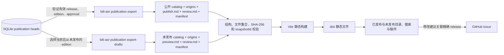

# Markdown 稿件阅读站

独立静态站点，展示主项目中正式发布的有效 release，以及明确标注审核状态的当前未发布编辑版本。
浏览器读取各自快照中的公开正文、AI 初稿的校验参照稿和读者元数据；SQLite、独立 AI 合成稿及内部事件留在主项目。

仓库初始保留两份合法空快照；本地联调使用的合成稿件不会作为正式内容提交。

## 产品定位与改动依据

项目面向长视频与系列讲解内容的学习者，提供可搜索、可连续阅读、可回看来源的文字资料库，服务阅读、查找、复习与核验。

后续功能、界面、内容组织和技术选型以 [项目哲学与产品原则](docs/product-philosophy.md) 为产品依据；仓库协作要求见 [AGENTS.md](AGENTS.md)。该文档记录长期目标与取舍，功能方向不代表已经实现；当前内容契约与运行方式以本 README 和代码为准。

## 架构



## 新前端边界

当前开发入口已经切换到独立的资料库应用。它围绕“资料库 → 搜索 → 阅读/核验 → 最近阅读”组织页面，使用新的 hash 路由：

```text
#/library
#/search?q=概念&view=all&mode=general
#/recent
#/read/<32 位 editionId>?flow=continuous&block=<正文锚点>
#/verify/<32 位 editionId>?block=<参照锚点>
```

新入口位于 `src/main-refactor.js`，页面服务位于 `src/refactor/`，构建和浏览器共用的纯内容逻辑位于 `packages/content-core/`。构建插件只读取并验证快照，再生成轻目录、按需详情、正文搜索候选和视频分片；正文、核验参照分别按需加载，本地状态由独立服务管理。旧查询参数、旧页面选择器和旧存储键不属于新契约，不提供兼容映射。

重构的产品依据仍是 [项目哲学与产品原则](docs/product-philosophy.md)：首屏优先内容查找，阅读器优先连续阅读和精确恢复，来源与版本事实集中在按需工具中。量化验收、模块依赖和删除旧实现的门槛见 [全量重构计划](docs/full-refactor-plan.md)。

阅读页在没有同视频目录时使用居中的正文单列，有目录时才在桌面启用双列。此布局服务文字读者的长文阅读，落实中文阅读优先和手机可用原则；正文宽度遵循当前浏览器的阅读设置，手机目录通过抽屉打开。浏览器回归脚本 `scripts/check-refactor-reader-layout-browser.js` 使用真实单 P、多 P 稿件，检查 320、390、900、901、1440、2048px 视口下的三种行宽、正文居中、横向溢出和目录抽屉。

## 本地运行

需要 Node.js 20 或更新版本及 pnpm：

```powershell
pnpm install --frozen-lockfile
pnpm dev
```

默认地址为 `http://127.0.0.1:5173`。开发服务器启动及生产构建均校验两份公开快照。
当前生产快照为 0 篇已发布、1,492 篇未发布；查看未发布稿件不会产生审核或正式发布事实。最新一批从已验证的本地生产备份导入，新增 264 篇预览，原有 1,228 篇保持完整版本与文件字节不变；来源、快照身份及验证依据见 [2026-10-11 备份产物导入](docs/production-backup-import-20261011.md)。

## 唯一内容契约与导入

本站只接受生产者显式导出的 `universal-origin-v1`：**catalog v3、content v2、source metadata v1、origins v1、manifest v2**。这些是独立版本。拒绝旧 catalog v1/v2、legacy article、混合新旧条目、publish-v1 和旧 manifest v1；不推断字段、不转换旧快照、不修改冻结 Markdown 或哈希。

上游契约固定于 [producer b584f6a](https://github.com/SuperCatQR/bilibili-asr-archive/blob/b584f6ac29b9e6acf598496c255ee73753063074/docs/preserved-body-import.md)。这是 PR #304 实现、PR #75/#77 已接入的来源交付策略，替代早期 issues #64/#68 提议的 manifest v1。导入步骤及来源说明见 [保留旧正文的迁移导入](docs/preserved-body-import.md)。

迁移后有归档证据的分 P 标题支持独立政策 `legacy-part-title-supplement-v1`，旧冻结政策保持原规则。证据、配套交付和验证边界见 [分 P 标题补充](docs/source-part-title-supplement.md)。

当前读取架构、#64–#68 修复映射、快照身份与验收/部署边界见 [通用契约修复交付](docs/universal-reader-delivery.md)。

旧入口的桌面与窄屏切换、导航层级和查找复测，以及 #80–#91 的历史修复映射见 [阅读层级与切换修复](docs/desktop-reading-hierarchy-fixes.md)。当前新入口能力与独立浏览器验收见下文及 [验收修复交付](docs/site-acceptance-fixes-20261011.md)。

在主项目生成完整的新格式公开和草稿目录：

```powershell
bili-asr publication export --archive-root C:\Archive\new-contract --out C:\Sites\markdown-reading-site\content --contract-profile universal-origin-v1
bili-asr publication export-drafts --archive-root C:\Archive\new-contract --out C:\Sites\markdown-reading-site\draft-content --contract-profile universal-origin-v1
```

输出根须与归档和产物互不重叠。默认导出完整范围；上游遇到范围内旧条目会整体失败，不能静默过滤。显式 `--release-id` / `--edition-id` 或 `--empty-scope` 只用于确实要公开的选择范围，不能用空目录替代未完成的内容交付。

```text
content/
  catalog.json
  origins.json
  publication-export-manifest.json
  articles/part-<videoPartId>/publish.md
  articles/part-<videoPartId>/review.md
draft-content/
  catalog.json
  origins.json
  publication-draft-export-manifest.json
  drafts/edition-<editionId>/preview.md
  drafts/edition-<editionId>/review.md
```

两份 catalog 只有 `schemaVersion: 3`、`manuscriptType` 和 `articles`。类型分别为 `publication` / `publication-draft`；空目录仍有 v3 catalog、空 origins 和 v2 manifest。每篇都包含完整 contentVersion=2 来源与编辑字段；允许 null 的字段也必须存在，未知字段拒绝。

稿件编辑字段 `title/summary/tags/attribution/editorNote` 与冻结的 `sourceMetadata` 分开。来源有 `platform/externalVideoId/partIndex`，视频身份为平台和大小写敏感外部 ID 的元组，分段按零基 partIndex 排序。Bilibili 来源 URL 必须准确绑定视频与 P；YouTube 使用规范 watch URL，当前 partIndex=0。来源 metadata 的 17 个字段、文本/标签边界、规范 URL、UTC 发布时间派生及身份相等均校验。未知源视频发布时间保持 null，不用创建、导入或观察时间补充；封面只允许安全 HTTPS hdslb.com 子域，其他未知封面为 null。

reader 数值范围采用 JavaScript 安全整数子集。原始 JSON 数字必须为无小数、无指数的十进制安全整数，越界值在使用前拒绝，不能舍入后通过校验。producer 的 int64 范围更宽；导入前应按 reader 校验预检，越界快照无法构建。

公开记录使用准确 release/edition/AI revision、content/artifact/review 哈希、publish-v2 与 Unix 秒正式发布时间。草稿有 edition 创建时间与五种审核状态，禁止 release、发布模板及发布时间。edition 是 32 位小写十六进制，其余 SHA-256 身份是 64 位；videoPartId 为正安全整数。`contentSha256` 对应完整冻结内容对象，不能从 catalog 投影重算；artifact/review 哈希对应原始文件字节。

manifest v2 只有 schemaVersion、manuscriptType、contractProfile、snapshotId、files；类型分别为 publication-export / publication-draft-export。files 按路径排序，准确登记 catalog、origins、正文和参照，不登记自身。snapshotId 是包含版本、类型、profile 和 files 的 canonical JSON 的 SHA-256，不再使用旧 v1 的仅 files 算法。所有原始文件哈希、有效 UTF-8、重复 JSON key、文件集合、路径、符号链接和残留目录在开发/构建前验证；内部 review.json、数据库、actors、audit、模型响应、凭据及未知目录不能进入快照。

origins 每篇唯一绑定准确 edition、revision、内容和 sourceMetadata 哈希，并区分原生 ai-generated-v2、保留旧正文 preserved-legacy-body 与迁移后编辑 edited-after-preservation。当前 1,492 篇均未发布、待审核，其中 1,103 篇保留旧正文，389 篇为原生 v2；最初 PR #77 导入 1,228 篇的保留证据见 [生产迁移记录](docs/production-preserved-import-20261010.md)，本次新增 264 篇的快照身份与验证依据见 [备份产物导入](docs/production-backup-import-20261011.md)。迁移不等于重新生成、审核或发布，历史 AI 参照保持真实 ai-draft-v1。

公开只包含有效当前 release，草稿只包含当前且从未发布的 edition。公开 A 与同 part 的新草稿 B 可以并存；相同 edition 不得跨两目录。批准 B 不改变 A；明确发布 B 后更新公开目录，撤回版不通过草稿重新公开。参照是对应 AI revision 的原始基线，不能当作后来人工 edition 的批准凭据。

两类快照可包含生产者 `--series-file` 导出的 series.json，必须登记 manifest 并参与 snapshotId。系列 v1 仍是编辑确认的 Bilibili 系列；其 BVID 成员明确匹配新文章的 bilibili/externalVideoId，并绑定当前类别完整版本与 partIndex 顺序。构建拒绝陈旧、错类别、漏项、乱序和未登记关联；不从标题或标签推断系列，当前生产输入没有录入系列。

两份导出命令不天然原子。使用同一归档读取边界或确认期间发布状态无变化，成对全量验证并整体替换受管目录；有状态变化就重新导出。备份、暂存、锁和恢复 journal 放在输入目录之外。部署失败保留上一有效站点，回退整份代码、双快照和静态产物，不让新代码消费旧快照。

## 阅读与修改建议

以下说明当前 `src/main-refactor.js` 入口，完整问题映射与验证见 [网站验收修复交付](docs/site-acceptance-fixes-20261011.md)。2026-10-09 至 2026-10-10 的交付文档记录旧入口的历史实现，不直接代表新入口能力；旧查询路由、存储和界面不迁移。

资料库默认按视频聚合全部内容，每批展示 32 个视频，分 P 按实际来源顺序。首页宣传段已按维护者要求删除，直接提供搜索、范围筛选和内容列表。正式发布为空时显示明确说明及公开预览入口；预览始终保留真实审核与未发布状态。来源主题采用冻结 sourceMetadata.tags，不回退到稿件编辑标签，也不生成标签或摘要。当前没有编辑确认的跨视频系列数据，不推断系列关系。

搜索使用共享纯核心的综合、原句和全部关键词语义，统一大小写与空白规范化。全部关键词允许同篇跨段证据。候选分区筛出可能相关的视频，再以最多六个并发请求读取视频正文分片，执行完整精确准入与排序；视频内查找只请求所选类别的本视频，核验查找只检查当前已加载参照。空查询不加载正文索引，任何导航取消旧任务，失败和损坏索引明确提示并可重试。全站搜索不再下载完整正文索引，但宽泛查询仍可能读取很多分片。

搜索视频组默认预览至多两个最相关 P，标题进入最相关稿件的首个正文命中；其余 P 按真实顺序展开，全部命中保留。证据按原文匹配再转义和高亮，不破坏 HTML 实体。查询、范围、方式、标签及排序属于分享路由。实际进入阅读前的列表数量、展开状态与滚动位置由独立 NavigationSession 保存，同一标签页刷新阅读页后仍可返回原列表；直接分享没有虚构的前序列表。

阅读和核验页直接显示对应正文，以及当前状态、真实分 P 和双向视图切换。单 P 在桌面使用居中正文列；多 P 才启用桌面侧边目录，小屏使用工具抽屉。连续阅读通过显式按钮逐篇追加同视频、同稿件类别的下一 P，保留已加载正文；进入下一 P 后更新标题、URL 与正文进度，回滚已加载内容时按实际可见 P 更新。每个阅读会话最多保留 20 篇正文，达到边界时继续到下一 P 的新会话。网络失败保留已读正文并允许重试。

来源、完整版本、目录、查找、设置及修改建议按需打开，工具局部更新，关闭后恢复焦点并保留阅读位置。工具具有对话框语义、Tab 焦点约束及 Escape 关闭；手机保留主题和连续阅读入口。主题切换和排版设置保持正文段落与段内位置。排版支持 17/19/21px、四档行距、620/760/920px 桌面行宽及宋体/黑体系统字体，手机宽度受屏幕限制。

正文历史保存在当前浏览器的 `reader-refactor-history-v1`（记录 schemaVersion=2），最多 20 篇，180 天到期，绑定类别、来源元组、videoPartId、contentVersion、edition、AI revision、完整内容及正文文件哈希，正式稿另绑定 release。位置采用规范段落锚点和段内相对偏移。显式链接锚点优先，其次会话位置，再其次准确版本的本地进度。参照视图不写正文历史；版本失配或撤回保留可管理的失效记录，不套用旧位置。损坏存储和写入失败不阻止阅读，写失败明确提示；不提供跨设备同步。

初始目录只加载轻量身份、标题、分 P 和摘要。完整冻结详情与 origin、正文及参照按需加载，并核对目录版本身份。生成资源使用输入指纹和部署子路径。成功资源缓存最多 256 项、估算 32 MiB，超预算资源不缓存，失败和取消不污染重试。构建仍严格验证 universal-origin-v1；当前原文、来源和审核/发布事实不被界面加工改写。

正文与核验均可在站内填写原句、上下文、建议和理由。完整反馈带当前段落链接、来源、准确 edition、AI revision、内容及正文/参照文件哈希，正式稿另带 release。正文和参照草稿按完整版本分别存于 sessionStorage，最多 10 份，每字段最多 4000 字符。复制文本与预填 GitHub Issue 使用相同段落链接；过长预填链接改为完整文本手动粘贴，复制或存储失败明确提示。打开预填页由读者确认提交，站点不自动创建 Issue，也不改变审核或发布事实。

两类 Markdown 原始 HTML 均禁用，外链使用 `noopener noreferrer`。内部审阅包、数据库、凭据等不能进入内容快照。收藏、跨设备同步、离线保存和在线协作仍未实现。

## 构建与部署

```powershell
pnpm test
pnpm validate
pnpm build
```

本仓库包含 GitHub Pages 工作流；Pages 来源设为 GitHub Actions 后，推送 `main` 会构建并部署。
公开地址为 `https://supercatqr.github.io/markdown-reading-site/`。
导出的 `content/` 与 `draft-content/` 分别作为快照提交；编辑、正式发布、撤回或替换后重新导出两份
快照、构建和部署，确认托管端旧文件和 CDN
缓存清理。后端的本地快照更新不能撤销已部署副本。
